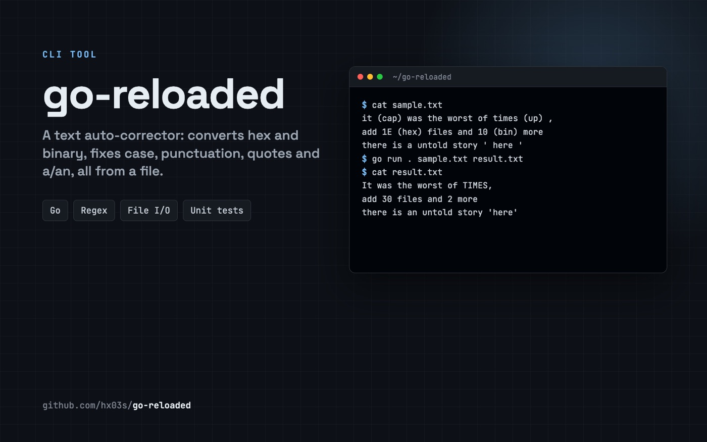

<div align="center">



# go-reloaded

**A text auto-corrector in Go: number conversion, case changes, punctuation, quotes and a/an, applied to a whole file.**

  

</div>

## Usage

```bash
go run . sample.txt result.txt
```

The program reads `sample.txt`, applies every rule below, and writes the corrected text to `result.txt`.

## Rules

| Marker / case | Before | After |
|---|---|---|
| `(hex)` | `1E (hex) files` | `30 files` |
| `(bin)` | `10 (bin) years` | `2 years` |
| `(up)` | `go (up)` | `GO` |
| `(low)` | `SHOUT (low)` | `shout` |
| `(cap)` | `bridge (cap)` | `Bridge` |
| `(up, n)` / `(low, n)` / `(cap, n)` | `so exciting (up, 2)` | `SO EXCITING` |
| Punctuation `. , ! ? : ;` | `there ,and then BAMM !!` | `there, and then BAMM!!` |
| Groups like `...` and `!?` | `I was thinking ... You were right` | `I was thinking... You were right` |
| Single quotes | `' awesome '` | `'awesome'` |
| a → an before a vowel or h | `a amazing rock` | `an amazing rock` |

## Examples

```
Input:  it (cap) was the best of times, it was the worst of times (up) ,
Output: It was the best of times, it was the worst of TIMES,

Input:  Punctuation tests are ... kinda boring ,don't you think !?
Output: Punctuation tests are... kinda boring, don't you think!?

Input:  There is no greater agony than bearing a untold story inside you.
Output: There is no greater agony than bearing an untold story inside you.
```

## Project structure

```
main/main.go                  read the input file, run the converters, write the output
internal/converters/hex.go    (hex) and (bin) to decimal
internal/converters/ulan.go   (up), (low), (cap) with optional counts
internal/converters/punc.go   punctuation and quote spacing
internal/converters/vowel.go  a → an
```

## Tests

```bash
go test ./...
```

Built at **[Reboot01](https://reboot01.com)**, Bahrain.

---

<div align="center">

Built by **Hasan Abdulla** · [github.com/hx03s](https://github.com/hx03s) · Bahrain 🇧🇭

</div>
